<div align="center">

# Identifiable alignment of unpaired representations

**Stas Syrota, Albert Lopez I Serrano, Johanne Franck, Søren Hauberg**<br>
Technical University of Denmark

**NeurIPS 2026**

**[Paper (PDF)](https://syrota.me/files/ngma.pdf)** · [Watch it](#two-latent-spaces-morphing-into-each-other) · [What we show](#what-we-show) · [Results](#results-in-numbers) · [How NGMA works](#ngma-as-the-code-runs-it) · [Reproducing the paper](#reproducing-the-paper) · [Citation](#citation)

</div>

**Two models trained apart, on different data or with different priors, share not one data point.
NGMA still finds which representation is which, with no pairs and no labels, and we prove when
that is possible.**

<p align="center">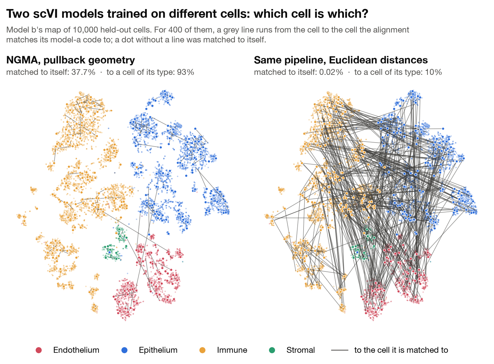</p>

<sub>Two scVI models trained on disjoint halves of the Tabula Sapiens lung cells (19,600 each).
With the pullback geometry, NGMA matches 37.7% of 10,000 held-out cells to themselves (chance is
0.01%) and 93% to a cell of their type; with Euclidean latent distances, 0.02% and 10%.</sub>

<table>
<tr>
<td align="center" width="33%"><h2>3,800× chance</h2>38% of 10,000 held-out lung cells matched to themselves, between models that never saw the same cell.</td>
<td align="center" width="33%"><h2>36/36 · 9/9</h2>lung samples and image settings in which NGMA is ahead of every baseline, label-informed ones included.</td>
<td align="center" width="33%"><h2>0.871 vs 0.071</h2>R@1 on FashionMNIST between VampPrior and Gaussian-prior VAEs: NGMA with no pairs, against a rigid map fitted on all the true pairs.</td>
</tr>
</table>

## Two latent spaces morphing into each other

<p align="center">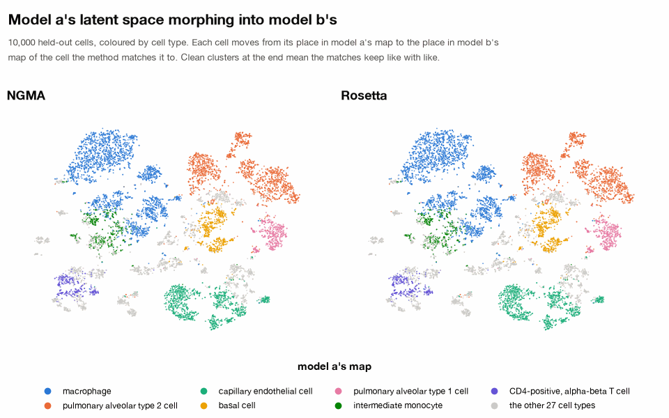</p>
<p align="center">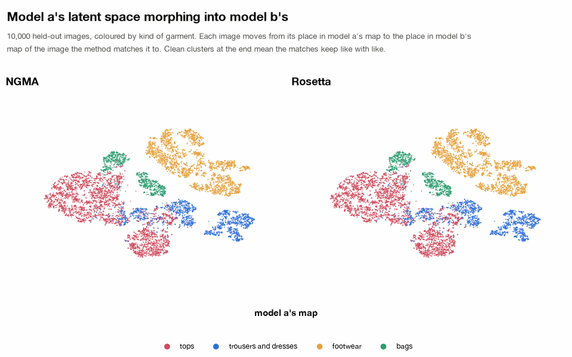</p>

<sub>Each point moves from its place in model a's map to the place, in model b's map, of the point
it is matched to; the path is drawn for display, the end point is the match. Top: scVI models of
lung cells trained on different cells. Bottom: FashionMNIST VAEs with a VampPrior and a Gaussian
prior, where Rosetta's matches fall on 1,679 of the 10,000 images and its map thins out.</sub>

## Real images, matched without pairs

<p align="center">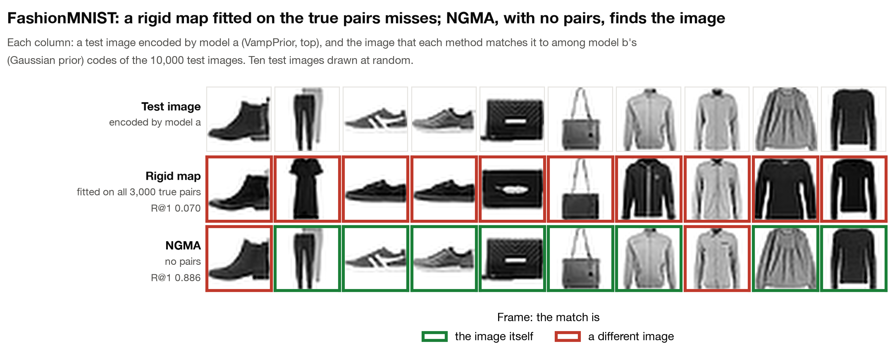</p>
<p align="center">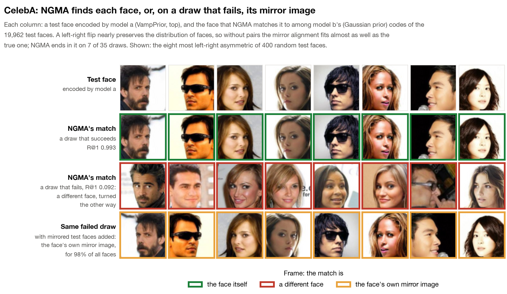</p>

<sub>Only dataset images are shown, never decoder output. The faces are matched model a to model b,
as in the paper's mirror test; the paper's tables combine both directions (R@1 0.995 and 0.11 on
these two draws). The mirror alignment is NGMA's main failure, on 7 of 35 CelebA draws.</sub>

## What we show

- **Any two models of one data-generating process share one geometry:** the pullback of the
  data metric. This holds whether the models are encoders, decoders or both, and whatever their
  architecture, loss, prior or training data. Euclidean latent distances are not shared: between
  a VampPrior and a Gaussian-prior VAE they differ in scale by a factor of five (below).
- **The alignment is identifiable.** It is the only map that preserves this geometry and carries
  one distribution of representations onto the other if and only if the data distribution breaks
  every symmetry of the data manifold, and generic distributions do.
- **It is recoverable from samples.** Under identifiability, the alignment coupling is the unique
  optimum of Gromov–Wasserstein and of fused GW. Recovery is exact when both models encode the same
  observations in any order, and consistent when they encode independent samples.
- **NGMA beats every baseline in every setting**, unpaired and label-informed alike, on single
  cells and on images, with no pairs and no labels.

<p align="center">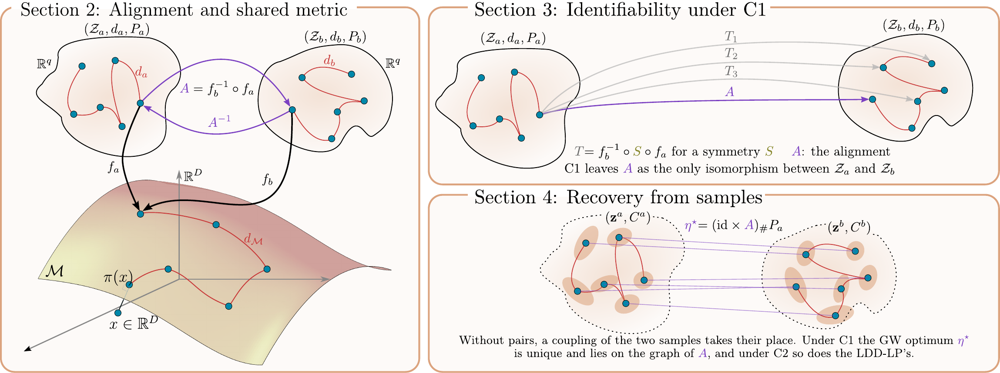</p>

<details>
<summary><b>The figure in words</b></summary>
<br>

Each model is a chart of the data manifold (H2), so the alignment map A = f<sub>b</sub><sup>−1</sup> ∘ f<sub>a</sub>
is a change of coordinates, and under the pullback metric each latent space is a metric measure
space isomorphic to the data's. A is *identifiable*, the only isomorphism between the two latent
spaces, if and only if no isometry of the data manifold other than the identity preserves the data
distribution (symmetry breaking, C1); otherwise each such symmetry S gives another isomorphism
f<sub>b</sub><sup>−1</sup> ∘ S ∘ f<sub>a</sub>. Without pairs, a coupling of the two samples takes
the place of the pairs. Under C1 the Gromov–Wasserstein optimum is unique and lies on the graph of
A. If almost every point has its own distribution of distances to the others (distinguishable
points, C2), a linear program between those distributions, the LDD-LP, finds the same optimum. NGMA
fuses the two problems, which keeps the unique optimum under C1 without needing C2. The coupling,
and with it A, is recovered exactly when both models encode the same observations, even without
identifiability, and consistently when they encode independent samples.
</details>

<p align="center">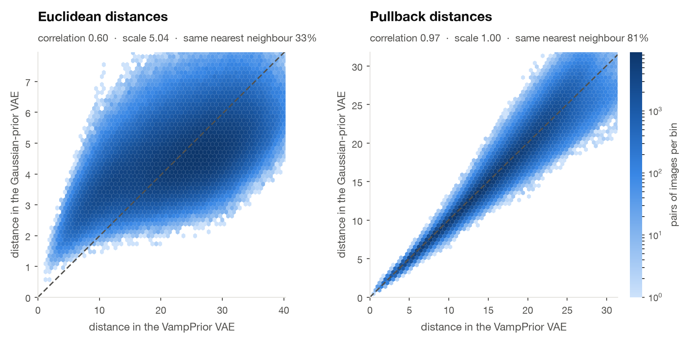</p>

<sub>The same 1,500 held-out FashionMNIST images in a VampPrior and a Gaussian-prior VAE, 1.1
million pairs. Euclidean latent distances disagree: one model's are about five times the other's,
and two thirds of the images have a different nearest neighbour in each model. Pullback distances
agree, at the same scale.</sub>

<details>
<summary><b>New to unpaired alignment?</b></summary>
<br>

An *alignment map* sends the representation of each data point in one model to the representation
of the same point in the other. With pairs, fitting it is regression. Without pairs, a single
representation means nothing on its own. What each model still has is the distances between its
representations and how they are distributed, and unpaired methods match those in the hope that
the map that matches them is the alignment.

That hope rests on the distances being the same in both models. Euclidean latent distances are
not: a model can stretch its latent space without changing what it decodes, and a different prior
does exactly that (the figure above). The *pullback metric* measures a short step in latent space
by how much it changes the decoded output, pixels for images and gene counts for cells, so it
follows the data rather than the coordinates. We compute it from an ensemble of eight decoders,
whose metric grows where they disagree, which is away from the data.

We score an alignment by R@1: the fraction of held-out data points whose own representation in the
other model is ranked first among all of them.
</details>

<details>
<summary><b>Know vec2vec, Rosetta or the Platonic representation hypothesis?</b></summary>
<br>

Recent unpaired methods align text encoders whose loss puts the representations on a sphere,
where matching similarity kernels makes the alignment a rotation; Rosetta imposes the sphere on
vision encoders before aligning them. We ask what two models share when nothing forces a sphere on
them. Under the metric manifold hypothesis (H1) and model coordinates (H2), any two models of one
data-generating process share the pullback of the data metric, and the alignment map is an
isometry of it that carries one distribution of representations onto the other.

That map need not be a rotation, and between VAEs with different priors it is far from one. On
FashionMNIST, a rigid map fitted on all the true pairs reaches R@1 0.071 between a VampPrior and a
Gaussian-prior model; NGMA reaches 0.871 without pairs, and the best unpaired baseline, Rosetta,
0.065. NGMA is ahead of Rosetta and mini-vec2vec in every setting of Table 1, and at every share of
images the two samples have in common.
</details>

<details>
<summary><b>Sceptical?</b></summary>
<br>

Good. Here is where NGMA falls short, and what we do not claim.

- **Near-symmetries break some draws.** On CelebA, 7 of 35 draws find the mirror alignment
  (mirror R@1 0.87–0.99, true R@1 at most 0.11; the faces above). Without pairs, it is almost
  indistinguishable from the true one.
- **The guarantees are for global optima,** which NGMA's solver may not reach.
- **The fused coupling is not always the best coupling.** On the sphere, from 8 landmarks on, it
  removes the seeds that GW alone leaves far from the truth, but the LDD-LP alone has the smaller
  median error for 32 to 256 landmarks.
- **Some leads are within the spread.** On FashionMNIST with Gaussian priors, NGMA reaches
  0.719 ± 0.112 and Rosetta 0.710 ± 0.040, and the rigid map on the true pairs 0.782.
- **Pairs still help.** NGMA's map class fitted on the true pairs reaches 0.995–1.000 in every
  image setting.
- **Equal dimensions only.** NGMA's maps act on whole latent spaces of equal dimension.
- **One modality.** The theory covers models of one data-generating process. Across modalities,
  the shared source of both data manifolds, and a metric that both induce, is the next step.
</details>

## Results in numbers

### Single cells: models that never saw the same cell

Two scVI models of Tabula Sapiens lung cells, each with the recipe of the published Tabula Sapiens
lung model, trained on disjoint halves of the cells, so they share only the tissue. We keep each
encoder, add seven decoders to its own, and measure distances under the Fisher metric of scVI's
negative-binomial likelihood, pulled back through the eight decoders. Both models encode the same
10,000 held-out cells, which gives the true pairs for scoring, never for fitting.

<p align="center">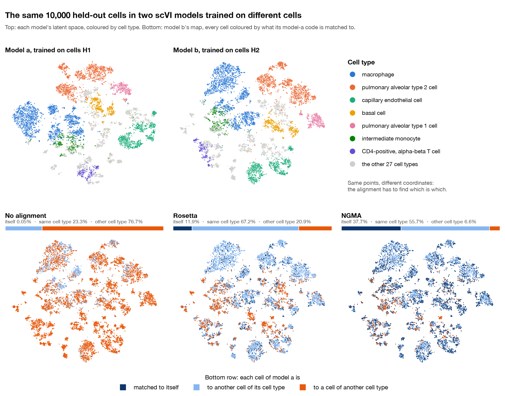</p>

<sub>Rosetta's map was not stored, so it was rerun on this draw with the paper's settings: R@1 0.119
in the rerun, 0.126 in the run behind the paper's tables.</sub>

<p align="center">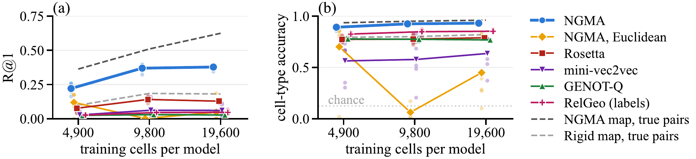</p>

NGMA ranks the true partner first for up to 38% of the 10,000 held-out cells and matches nine in
ten to a cell of the right type among 34. It is above every baseline on all 36 samples, RelGeo with
cell-type labels included. With Euclidean latent distances the same pipeline fails on most draws,
and with the pullback metric of the scVI decoder alone, instead of the eight-decoder ensemble, it is
lower on 17 of 18 draws.

### Images: different priors, samples that share no image

R@1 among 10,000 held-out test images (19,962 on CelebA), with the two samples drawn disjoint
(3,000 images per side, 7,500 on CelebA), as mean ± s.d. over model pairings and draws. The
unpaired baselines are Rosetta, mini-vec2vec, GENOT-Q and LFM, the label-informed ones RelReps and
RelGeo. The last two columns fit NGMA's map and a rigid map on the true pairs.

| | Prior | **NGMA** | Best unpaired | Best label-informed | NGMA's map, true pairs | Rigid map, true pairs |
|---|---|---|---|---|---|---|
| MNIST | Gaussian | **0.967** ± 0.021 | 0.941 ± 0.028 | 0.525 ± 0.069 ‡ | 0.998 | 0.955 |
| | VampPrior | **0.989** ± 0.012 | 0.930 ± 0.012 | 0.552 ± 0.235 | 1.000 | 0.936 |
| | cross-prior | **0.955** ± 0.008 | 0.571 ± 0.021 | 0.319 ± 0.152 | 0.999 | 0.512 |
| FashionMNIST | Gaussian | **0.719** ± 0.112 | 0.710 ± 0.040 | 0.159 ± 0.134 | 0.997 | 0.782 |
| | VampPrior | **0.979** ± 0.027 | 0.656 ± 0.045 | 0.355 ± 0.131 | 1.000 | 0.747 |
| | cross-prior | **0.871** ± 0.049 | 0.065 ± 0.019 | 0.098 ± 0.033 | 0.998 | 0.071 |
| CelebA | Gaussian | **0.804** ± 0.375 (12/15) | 0.567 ± 0.453 (8/15) | 0.445 ± 0.033 ‡ | 0.995 | 0.993 |
| | VampPrior | **0.818** ± 0.372 (8/10) | 0.616 ± 0.415 † (7/10) | 0.387 ± 0.139 | 0.996 | 0.995 |
| | cross-prior | **0.818** ± 0.372 (8/10) | 0.757 ± 0.372 (8/10) | 0.220 ± 0.120 | 0.996 | 0.990 |

<sub>The best unpaired baseline is Rosetta, or mini-vec2vec where marked †. The best label-informed
baseline is RelGeo, or RelReps where marked ‡. On CelebA, parentheses count draws reaching R@1 of
0.3; the failed draws are the mirror alignments of the faces above.</sub>

On MNIST and FashionMNIST, NGMA without pairs beats a rigid map fitted on all the true pairs in
five of six settings, and between priors by 0.44 on MNIST and 0.80 on FashionMNIST. When both
samples are the same images, NGMA reaches 0.990–0.999 in every MNIST and FashionMNIST setting.

<p align="center">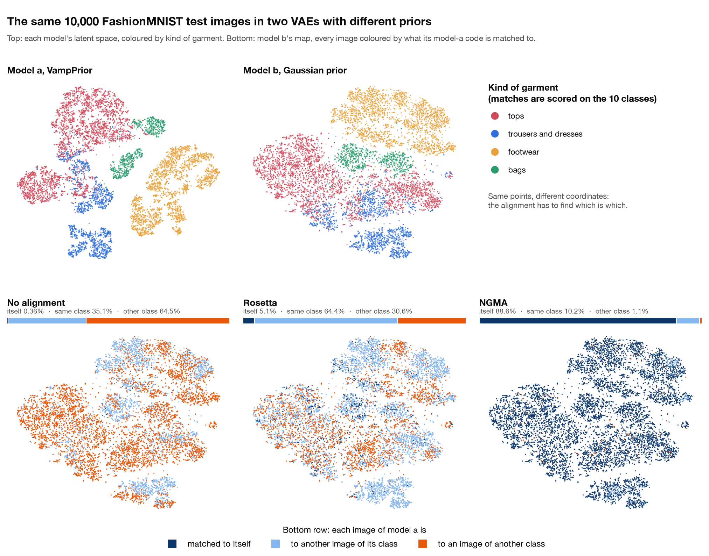</p>

<sub>Rosetta was rerun as for the lung (R@1 0.051 in both runs).</sub>

### On the sphere, symmetry breaking decides recovery

<p align="center">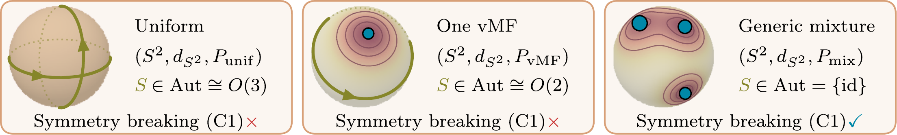</p>
<p align="center">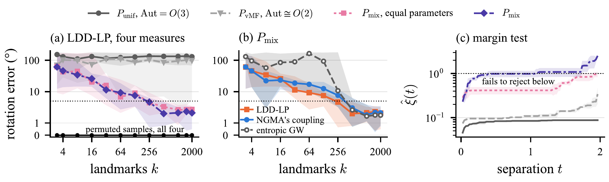</p>

Here we choose the alignment ourselves: model b rotates the data by a fixed R. Under the uniform
measure and a single von Mises–Fisher, some rotations preserve the measure, and the recovered
rotation stays far from R however many landmarks we use (a). The two mixtures break every symmetry,
and from independent samples the LDD-LP recovers R to within 5°; from the same points in a
different order it recovers R exactly for every measure, from 3 landmarks on. On the mixture, GW
alone leaves 4 to 8 of 10 seeds more than 90° from R at every k up to 256, and NGMA's coupling none
from k = 8 (b). The margin test (c) never rejects equal distance distributions for the two
symmetric measures, and for the mixtures only for pairs of points far apart.

## NGMA, as the code runs it

The method's entry points are in `scripts/`; every experiment calls them.

1. **Models.** VAEs with an ensemble of 8 decoders on one encoder, trained with β = 16 and a
   learned observation scale (`configs/vae_*.yaml`; `scripts/train_vae.py`). Latent dimension 16
   on MNIST and FashionMNIST, 32 on CelebA; standard Gaussian prior or a VampPrior.
2. **Sources** (`scripts/prepare_sources.py`). A pool of held-out images is encoded by both
   models. Each side's geometry is the decoder ensemble's expected pullback metric: the metric
   tensor at every pool code and the lengths of the straight segments between codes (32 steps,
   each step's length the root mean over decoders of the squared output change).
3. **Carves** (`scripts/carve.py`). A sample pair is two index sets into the pool: disjoint
   (no image on both sides; the regime of the tables), paired (true pairs, for the Procrustes
   baseline and the anchors of LFM) and 100 % overlap in independent orders (the carve the
   supervised ceilings are fitted on).
4. **Coupling** (`scripts/couple.py`). Entropic Gromov-Wasserstein between the two distance
   matrices, annealed in four stages from ε = 1 to 10⁻³, each stage started from the previous
   plan. At every Frank-Wolfe step the cost carries a linear term, Mémoli's third lower bound
   (the squared 2-Wasserstein distance between the two points' distance distributions), with
   weights α = 1, 2/3, 1/3, 0 over the stages and temperatures interpolating geometrically
   between GW's schedule and the lower bound's own, so the last stage is plain entropic GW.
   Float64, inner Sinkhorn to convergence with warm-started dual potentials.
5. **Map** (`scripts/fit_map.py`). Two maps φ(z) = Wz + t + h(z) and ψ(w) = W'w + t' + h'(w),
   with two-hidden-layer GELU MLPs of width 128, started at the plan's weighted Procrustes map
   and its inverse, trained on one objective: the isometry terms (the pullback metric of each
   side carried to the other), 0.3 times the fit to the plan's argmax targets, and 0.1 times the
   cycle term. Adam 10⁻³, batches of 256, 3000 steps; every 250 steps the pair is scored by the
   held-out mutual-nearest-neighbour fraction and the best checkpoint is kept, the rigid start
   being a candidate. Then up to three joint rounds of 1000 steps in which the mutual nearest
   neighbours of the combined ranking of the two maps replace the targets; the round with the
   largest held-out mutual-NN fraction is kept.
6. **Score.** The combined ranking of the two maps on the paired test split: R@1 is the
   fraction of test images whose true partner is ranked first.

The supervised ceiling (`fit_map.py --ceiling`) trains the same map class on the true pairs of
the 100 %-overlap carve, in both directions, and scores the same test split; the Procrustes
map on those pairs is scored beside it.

The baselines are in `baselines/`: Procrustes on the true pairs, RelReps-Centroid and the three
LFM variants from the carved codes (`cached_baselines.py`), RelReps (`run_relreps.py`), RelGeo
with path lengths under the same decoder geometry (`relgeo_lengths.py`, `run_relgeo.py`),
GENOT-Q on the Euclidean and on the pullback cost (`genot_q.py`), Rosetta and mini-vec2vec
through the authors' package (`linear_baselines.py`, `rosetta.py`). `baseline_metrics.py` is the
retrieval and CSLS scoring they share.

## Reproducing the paper

The repository reproduces three results of the paper. Each has one driver in `bash/` and its own
code in `experiments/`:

| result | driver | code |
|---|---|---|
| Table 1: instance retrieval between independently trained VAEs on MNIST, FashionMNIST, CelebA | `bash/images.sh` | `experiments/images/` |
| Figure 3: alignment and the margin test on the sphere | `bash/sphere.sh` | `experiments/sphere/` |
| Figure 4 and the lung table: scVI models of Tabula Sapiens lung cells | `bash/lung.sh` | `experiments/lung/` |

### Install

```bash
pip install -e .          # Python >= 3.10; JAX with GPU support as your platform requires
export PYTHONPATH=src     # every entry point needs this
```

Two parts run in their own environments: Rosetta and mini-vec2vec through the authors' package
(`pip install -e '.[rosetta]'`, see `baselines/rosetta.py`), and the lung experiment's scVI
models (`pip install -e '.[lung]'`).

### Table 1: the image experiments

`bash bash/images.sh <mnist|fmnist|celeba>` runs, for one dataset, every step above and skips
outputs that exist; `bash bash/images.sh table` then writes
`results/tables/main_results.tex` and `results/tables/Headline_summary_disjoint.csv`
(`experiments/images/table1.py`). Data: MNIST and FashionMNIST download themselves; CelebA is
read from `data/celeba/celeba_{train,val,test}_{images,labels}.npy` (64 × 64 × 3 images in
[0, 1], attribute labels), built from the aligned-and-cropped release.

The grid of the table:

| | MNIST, FashionMNIST | CelebA |
|---|---|---|
| models per prior | a b c d (seeds 42 123 7 8) | Gaussian a b c d, VampPrior a b c |
| same-prior pairings | ab ac ad bc bd cd | Gaussian ab ac ad, VampPrior ab ac |
| cross-prior pairings (VampPrior model × Gaussian model) | aa ab ba bb | aa ba |
| pool, points per side | 6000, 3000 | 15000, 7500 |
| draws (carve seeds): NGMA, Rosetta, mini-vec2vec | 1–5 | 1–5 |
| draws: the ceiling | 1–2 | 1–5 |
| draws: the other baselines | 1–2 | 1–2 (VampPrior ab: 1–5) |

A cell of the table is a dataset and a prior; its mean is over pairings of the per-pairing mean
over draws, the spread the s.d. over all draws.

Every step is deterministic given its seed, but k-means, the QAP solver and GPU reductions differ
in their last digits across machines and library builds, so a rerun on other hardware agrees with
the paper to about 10⁻³ in R@1, not to the last digit.

<details>
<summary>Output layout</summary>

```
checkpoints/<dataset>_<prior>/vae_<x>/best_model.pickle
sources/<dataset>_<prior>_<xy>/                 Za Zb labels, the test codes, C_<mode>_{a,b}, G_{a,b}
carves/<root>/seed<S>/{disjoint,paired,frac100}/
carves/<root>/seed<S>/disjoint/alignments/ensemble_eol_samedec_kn_FGWG_ann/pi.npy
results/fits/<root>_s<S>.json (+ _mapped.npz)   NGMA
results/ceilings/<root>_s<S>.json               the supervised ceiling
results/baselines/{cached,relreps,relgeo,genot,rosetta_wp,minivec2vec_official}/
results/tables/
```
</details>

### Figure 3: the sphere

`bash bash/sphere.sh` runs the alignments on the four measures of `configs/sphere_measures.yaml`
(independent and permuted samples, seeds 10–19, `experiments/sphere/run.py`, settings in
`configs/sphere.yaml`), collects them (`collect.py`), runs the margin test (`margin_test.py`,
seeds 0–2) and draws the figure (`figure.py`). The LDD-LP compares two landmarks by W₂² between
their distance distributions and is solved exactly by network simplex. Panel (b) adds, on the
mixtures with independent samples, NGMA's coupling and its annealed GW alone. The rotation is
fitted in closed form. CPU only; the full-cloud fused coupling takes one to three hours per run on
one thread, so the whole grid takes about a day at eight runs in parallel.

### The lung experiment: Figure 4 and the lung table

Two scVI models of the same RNA data, trained on different cells or on the same cells with
different seeds, aligned with NGMA's pullback geometry and scored on held-out cells that both
models encode. The scripts are in `experiments/lung/`.

<details>
<summary>The steps</summary>

- **Data.** Tabula Sapiens lung, the 62,954 10x 3' v3.1 cells of four donors, 3,000 genes, raw
  counts; Smart-seq2 cells dropped. 34 cell types, 4 compartments. No batch covariate. Inputs:
  `lung_train.h5ad` (the counts) and `ts_lung_full.h5ad` (the labels, joined by barcode).
  `prep.py`.
- **Split, by cell** (seed 0): 10,000 eval cells, scored with known pairs; a pool of 9,000
  held-out cells that both models encode; the rest cut into two disjoint training halves H1, H2,
  each with nested subsets of 4,900 < 9,800 < 19,600 cells.
- **Models.** scVI (latent 20, three hidden layers of 128, layer norm, gene dispersion, negative
  binomial, observed library size, 400 epochs), one per (half, size, seed in {0, 1}): 12 models.
  `fit_scvi.py`.
- **Decoder ensembles.** Head 0 is the scVI decoder, so M = 1 is plain scVI; heads 1-7 are
  trained with the encoder frozen, on codes sampled from its posterior q(z|x) of the model's own
  training cells, at its gene dispersions. `decoder_heads.py` refuses unless head 0 reproduces
  scVI's decoder.
- **Geometry.** φ = 2 √θ asinh(√(l_ref ρ / θ)) per head, the coordinate in which the Fisher
  metric of the negative-binomial mean is Euclidean (l_ref the median library size). The
  M-decoder ensemble metric and straight-segment lengths with T = 10 steps, for M = 1 and M = 8,
  on the pool and eval cells. `geometry.py`.
- **Pairs**, per training size: `cross1/2` (H1 against H2, different cells, seeds 0 and 1) and
  `within1/2` (two seeds on the same half).
- **Sources and carves.** One source per (pair, M), M in {1, 8, euc}; `euc` is the Euclidean
  comparator (Euclidean latent distances, identity metric). From each source, n = 3,000 cells
  per side, three draws, in two regimes: disjoint (no cell on both sides) and 100 % overlap
  (the same cells in independent orders, for the ceilings and the coupling accuracy). `make_sources.py`, then
  `scripts/carve.py`.
- **Coupling.** NGMA's coupling on the pullback cost for M = 1 and 8; the annealed GW coupling
  on the Euclidean cost for the comparator. `scripts/couple.py`.
- **Map.** `scripts/fit_map.py` with the settings above, both directions, scored by the combined
  ranking on the 10,000 eval cells. Every disjoint fit also reports the two ceilings on its
  100 %-overlap sibling: the same map class and the Procrustes map, both fitted on the true pairs
  and scored a → b. `fit_maps.py` runs the fits of several carves in one process.
- **Baselines**, on the disjoint M = 8 carves: Rosetta and the official mini-vec2vec
  (`baselines/linear_baselines.py`), GENOT-Q with the Euclidean and the pullback cost
  (`baselines/genot_q.py`), RelGeo on segment lengths to the class-centroid anchors
  (`relgeo_lengths.py`, then `baselines/run_relgeo.py --geo-mode precomputed`).
- **Readout.** `read_fits.py` (R@1, R@1 within cell type, cell-type and compartment accuracy,
  FOSCTTM, CSLS@1 and the ceilings, from each fit's saved mapped eval cells) and
  `read_baselines.py` (the baselines a → b). `paper_tables.py` writes the lung tables, Figure 4
  and the numbers the text quotes; the paper's lung table is `tab_lung_baselines.tex`.
</details>

Everything lives under one root directory outside the repository: `lung10x.h5ad`, `split.npz`,
`split_meta.json`, `labels.npz`, then `fits/`, `geometry/`, `sources/`, `carves/`, `results/`,
`baselines/`, `tables/`.

```bash
ROOT=/path/to/lung SRC=/path/to/h5ad_files PY_SCVI=/path/to/scvi/python PY=python \
    bash bash/lung.sh [stage ...]
```

runs the stages `prep fit heads geometry sources carve couple fits baselines readout tables` in
order, or the ones named; each skips outputs that exist. `PY_SCVI` is an environment with
`scvi-tools`, `anndata` and `torch`, for the models and heads; `PY` is the repository's JAX
environment, for the rest. The geometry, couplings and fits run on a GPU; the models, heads and
baselines on CPU.

### Layout

```
src/ngma/             models (VAE, priors), losses, training, geometry (segment lengths, metric
                      tensors, signatures), alignment (entropic GW with the linear term, closed-form
                      maps), evaluation (retrieval, CSLS, LFM), data loaders
scripts/              the method's entry points: train, prepare sources, carve, couple, fit the map
baselines/            the baselines and their shared scoring
experiments/images/   Table 1 from the result files
experiments/sphere/   the sphere experiment and Figure 3
experiments/lung/     the lung experiment, its tables and Figure 4
bash/                 one driver per experiment: images.sh, sphere.sh, lung.sh
configs/              the VAE configs and the sphere settings
assets/               the figures of this README
```

## Citation

```bibtex
@inproceedings{syrota2026identifiable,
  title     = {Identifiable alignment of unpaired representations},
  author    = {Syrota, Stas and Lopez I Serrano, Albert and Franck, Johanne and Hauberg, S{\o}ren},
  booktitle = {Advances in Neural Information Processing Systems},
  year      = {2026}
}
```

## Acknowledgements

This work was supported by a research grant (42062) from VILLUM FONDEN. This project received
funding from the European Research Council (ERC) under the European Union's Horizon research and
innovation programme (grant agreement 101125993). The work was partly funded by the Novo Nordisk
Foundation through the Center for Basic Machine Learning Research in Life Science (NNF20OC0062606).
We acknowledge the DTU Computing Center for awarding this project access to the LUMI
supercomputer, owned by the EuroHPC Joint Undertaking, hosted by CSC (Finland) and the LUMI
consortium.
